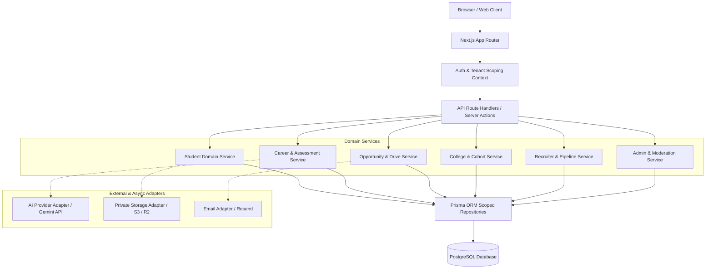

# StepBridge.ai — Architecture Specification

## 1. System Overview & Architecture Style
StepBridge.ai is built as a **Modular Monolith** using the Next.js App Router and TypeScript. 
- **Presentation Layer**: Role-aware routes partitioned into `(public)`, `(auth)`, `(student)`, `(college)`, `(recruiter)`, and `(admin)`.
- **API & RPC Layer**: Next.js Route Handlers located under `/api/v1/` returning standardized JSON envelopes with request tracing and error codes.
- **Domain Services**: Encapsulated business logic in `src/modules/*` ensuring strict separation of concerns, transactional integrity, and deterministic fallback behaviors.
- **Data Persistence**: Prisma ORM with strict UUID schemas, foreign keys, tenant scoping, and composite indexes.
- **AI Integration**: Unified Provider Abstraction with structured Zod response validation, token usage tracking, and deterministic rule-based fallbacks.

## 2. Request & Execution Flow
1. **Inbound Request**: User issues an HTTP request to `/api/v1/*` or navigates to a protected workspace page.
2. **Context Resolution**: The request is inspected for the HTTP-only secure session cookie. The user identity and tenant membership (`institution_id` or `company_id`) are resolved.
3. **Authorization Check**: The policy engine validates role permissions against the requested endpoint and verifies tenant boundaries (`tenant_id == resource.tenant_id`).
4. **Input Validation**: Request bodies/query params are parsed and sanitized with Zod schemas.
5. **Domain Execution**: The domain service executes business rules in a database transaction when modifying multi-entity states (e.g. applications, stage events, drive publishing).
6. **Response Envelope**: Standard JSON response returned: `{ "data": {...}, "meta": { "requestId": "..." } }`.

## 3. Asynchronous & AI Processing
- Long-running tasks (e.g. detailed resume analysis, roadmap generation) employ background jobs with state tracking in `ai_jobs`.
- Every AI interaction logs prompt version, provider, model name, token usage, latency, and estimated cost in `ai_usage_events`.
- Strict schema validation guards against malformed LLM responses, automatically invoking a retry or clean deterministic fallback.
