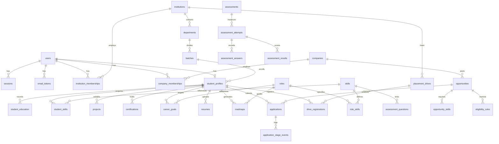

# StepBridge.ai — Database Specification

## 1. Overview
The database uses PostgreSQL with UUID primary keys (`id`), standard timestamp audit fields (`created_at`, `updated_at`), strict foreign keys, foreign key cascading or restricted rules, and tenant scoping.

## 2. Entity Relationship Diagram (ERD)

## 3. Core Tables Specification

1. **`users`**:
   - `id`: UUID (PK)
   - `name`: VARCHAR(255)
   - `email`: VARCHAR(255) (UNIQUE, lowercase normalized)
   - `password_hash`: VARCHAR(255)
   - `role`: ENUM ('STUDENT', 'COLLEGE_ADMIN', 'PLACEMENT_OFFICER', 'COMPANY_ADMIN', 'RECRUITER', 'SUPER_ADMIN')
   - `status`: ENUM ('ACTIVE', 'PENDING_VERIFICATION', 'SUSPENDED')
   - `email_verified_at`: TIMESTAMP NULL
   - `created_at`, `updated_at`

2. **`institutions`**:
   - `id`: UUID (PK)
   - `name`, `website`, `domain`, `city`, `state`
   - `verification_status`: ENUM ('PENDING', 'APPROVED', 'REJECTED')
   - `rejection_reason`: TEXT NULL

3. **`companies`**:
   - `id`: UUID (PK)
   - `name`, `website`, `domain`, `description`, `industry`
   - `verification_status`: ENUM ('PENDING', 'APPROVED', 'REJECTED')
   - `rejection_reason`: TEXT NULL

4. **`student_profiles`**:
   - `id`: UUID (PK)
   - `user_id`: UUID (FK -> users.id, UNIQUE)
   - `institution_id`: UUID NULL (FK -> institutions.id)
   - `batch_id`: UUID NULL (FK -> batches.id)
   - `headline`, `bio`, `phone`, `location`
   - `cgpa`: DECIMAL(4,2)
   - `visibility`: ENUM ('PRIVATE', 'INSTITUTION_ONLY', 'VERIFIED_RECRUITERS')
   - `completion_percentage`: INT DEFAULT 0

5. **`skills` & `roles`**:
   - `skills`: `id`, `canonical_name`, `category`, `aliases` (TEXT/JSON), `active`
   - `roles`: `id`, `title`, `description`, `category`, `active`
   - `role_skills`: `role_id`, `skill_id`, `required_level` (1-5), `importance_weight` (1-5)

6. **`assessments` & `assessment_questions`**:
   - `assessments`: `id`, `title`, `skill_id` (FK), `duration_minutes`, `question_count`, `pass_percentage`
   - `assessment_questions`: `id`, `assessment_id`, `difficulty`, `question`, `options` (JSON), `answer_key`, `explanation`

7. **`roadmaps`, `roadmap_milestones`, `roadmap_tasks`**:
   - 4-, 8-, or 12-week time horizon with ordered milestones and actionable learning tasks with verification criteria.

8. **`opportunities`, `eligibility_rules`, `applications`**:
   - `opportunities`: company jobs and internships.
   - `eligibility_rules`: rules (e.g. `min_cgpa`, `allowed_batches`, `allowed_departments`).
   - `applications`: `id`, `opportunity_id`, `student_id`, `stage`, `resume_id`, `profile_snapshot` (JSONB immutable snapshot), `applied_at`.
   - `application_stage_events`: historical state transition log with actor notes.

9. **`placement_drives` & `drive_registrations`**:
   - College campus drives with registered/external companies, candidate registration funnel, and outcome records.

10. **`audit_logs`, `ai_jobs`, `ai_usage_events`, `notifications`**:
    - Complete tracking of system operations, AI token usage, costs, and transactional notifications.
